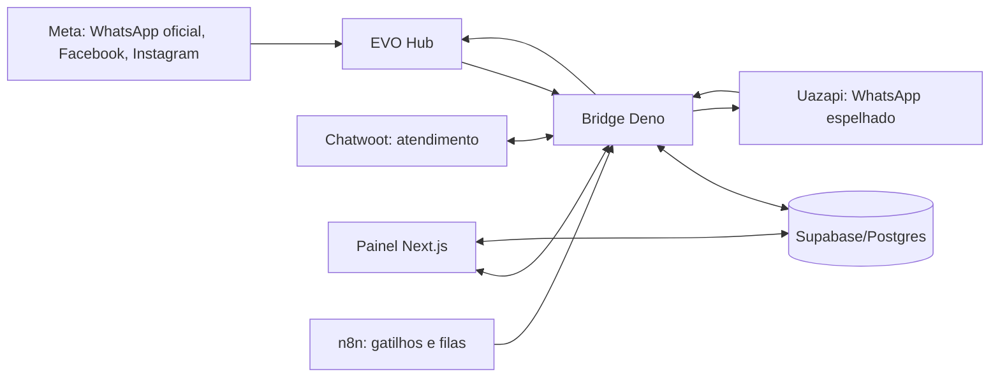

# Arquitetura e fluxos do EvoHub

**Recorte:** código da `main` em `08c6e5c`, 22/10/2026. **Estado:** mapa de implementação; não é uma medição de disponibilidade em tempo real.

## Visão geral

O `bridge/server.ts` é o ponto de entrada HTTP e registra os ciclos internos. `bridge/handlers/` recebe uma requisição e a entrega a `bridge/shared/`, onde ficam regras de negócio, integrações e estado. `web/app/` contém as páginas do painel. `supabase/migrations/` define o histórico do esquema. `ops/` contém ferramentas de operação, algumas delas com efeitos reais em produção.

## Caminho de uma mensagem recebida

1. O provedor entrega o evento em `/hub-webhook` ou `/uazapi-webhook`. Chatwoot também envia seus eventos em `/chatwoot-webhook`.
2. O handler identifica canal, contato e mensagem. A lógica compartilhada em `shared/inbound.ts` e `shared/customer.ts` registra a entrada, normaliza identidade e evita ecos/duplicatas.
3. Uma resposta pode interromper mensagens agendadas, avançar `campaign_flow_state` via `shared/flow-inbound.ts`, ou seguir para intenção, funil e atendimento humano. O controle de pausa e bloqueio está em `shared/bot-mute.ts`, `shared/gate-comercial.ts` e `shared/stop-contact.ts`.
4. O registro persistente permite que painel, auditoria e processos de recuperação comparem evento, estado e saída.

Se o webhook falhar, `shared/catchup-uazapi.ts` consulta o histórico do provedor. O ciclo `startInboundWatchdogLoop` em `server.ts`, `shared/inbound-incidents.ts` e `/inbound-incidents` tratam visibilidade e recuperação de entradas ausentes. O caso de botão do 0595 em 21/10 motivou a detecção do webhook ausente e a aceitação de `TemplateButtonReplyMessage` no catchup ([PR #32](https://github.com/Camposoberano/evohub-bridge/pull/32)). O monitor só é evidência de funcionamento quando há eventos reais e entrega de saída confirmada.

## Caminho de uma mensagem enviada

1. Uma ação do atendente, do painel, de uma campanha, de um fluxo ou de n8n chega a `send-outbound`, `campaign`, `funil-*` ou a uma rota específica.
2. `shared/campaign-preflight.ts`, `shared/campaign-pace.ts`, `shared/gate-comercial.ts` e `shared/flow.ts` verificam elegibilidade, limite, bloqueios e próximo passo.
3. O envio é encaminhado por `shared/hub.ts` ou `shared/uazapi.ts`. `shared/hybrid*.ts` contém as regras da rota híbrida.
4. O bridge persiste tentativa, resultado, identificadores e relação com Chatwoot. Uma resposta de API não deve ser tratada automaticamente como entrega ao cliente; a confirmação depende do tipo de recibo e do provedor.

## Campanhas, rotação e funis

`shared/campaign-queue.ts` mantém itens da fila; `shared/campaign-pace.ts` controla cadência; `shared/campaigns.ts` descreve campanhas. O ciclo de fila em `server.ts` reserva um item, faz preflight, envia e marca resultado. A rotação diária entre 5895, 0595 e 6836 entrou na [PR #30](https://github.com/Camposoberano/evohub-bridge/pull/30), com especificação em [rotação por número](superpowers/specs/2026-10-21-rotacao-campanhas-por-numero-design.md). A meta por número, janela e ordem precisam ser lidas junto com a configuração ativa do dia.

Há duas camadas de jornada que não devem ser confundidas:

| Camada | Responsabilidade | Código principal |
|---|---|
| Campanha/fila | Selecionar contato, cadência e envio inicial | `campaign-queue.ts`, `campaign-pace.ts`, `campaign.ts` |
| Fluxo conversacional | Esperar resposta, ramificar, manter posição e timeout | `flow.ts`, `flow-runner.ts`, `flow-state.ts`, `flow-inbound.ts` |
| Funil agendado | Enfileirar peças, pausar, retomar e recuperar | `funil-enroll.ts`, `funil-control.ts`, `funnel-queue.ts`, `funnel-recovery.ts` |
| Recuperação de entrada | Buscar resposta que o webhook não entregou | `catchup-uazapi.ts`, `inbound-incidents.ts`, `server.ts` |

O [motor de fluxo](motor-de-fluxo.md) explica as regras de ramificação. Para saber se uma campanha específica usa um fluxo, consulte a configuração da campanha e o estado persistido; a presença de um plano em `docs/superpowers/` não confirma ativação.

## Ciclos e observabilidade

`server.ts` registra ciclos de sincronização social, saída Chatwoot, etiquetas, métricas, retenção, limpeza, fila de funil, watchdog de anúncios, fila de campanhas, retomada, timeouts, PDFs diferidos, catchup Uazapi, auditoria operacional e watchdog de entrada. Alguns usam `agendarLoop` para evitar reentrância; outros usam `setInterval`. A lista e os intervalos exatos estão no [catálogo de funções e comandos](funcoes-e-comandos.md) e no código de `server.ts`.

`/health` e `/version` informam disponibilidade e inicialização do serviço. `/operational-health` e `/inbound-incidents` expõem auditoria de falhas. O painel usa páginas como `/acompanhamento`, `/disparos`, `/conversas`, `/reativacao`, `/fluxos`, `/campanhas` e `/eventos`. Para diagnosticar uma mensagem, compare, nesta ordem: clique ou mensagem no provedor, evento recebido no bridge, entrada persistida, posição do fluxo, envio ao provedor e recibo de entrega.

## Fronteiras que precisam permanecer claras

- **Provedor ≠ bridge:** o provedor pode registrar um clique que o bridge não recebeu. O webhook e o catchup cobrem caminhos diferentes.
- **Aceito ≠ entregue:** um retorno de API pode preceder a confirmação de entrega; não avance uma jornada crítica apenas pela aceitação.
- **Plano ≠ configuração ativa:** documento de design não altera campanha, fila ou ambiente.
- **Canal ≠ contato:** deduplicação e bloqueio devem usar o identificador certo do canal e do cliente.
- **Monitoramento ≠ recuperação:** alerta aponta a falha; reenvio exige checar idempotência, estado do fluxo e saída já entregue.
